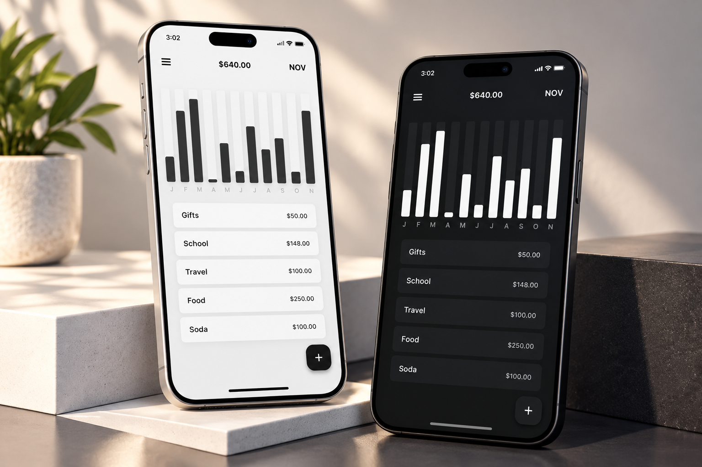

<div align="center">

# 💰 Expense Tracker App

### Flutter • Dart • Personal Finance Management

A modern personal expense tracking application built with
**Flutter and Dart**, designed to help users organize their
daily expenses and better understand their spending habits.


</div>

---

## 📸 Project Preview

<div align="center">

<a href="815fb379-153f-4c35-9f30-23de3ed63a64.png">
  
</a>

</div>

---

## 📖 About the Project

**Expense Tracker** is a Flutter application
designed to make personal expense management
simple and accessible.

The application provides a user-friendly
interface for recording financial transactions,
organizing spending information, and reviewing
expense activity.

It demonstrates Flutter application development,
form handling, state updates, and financial
data presentation.

---

## ✨ Key Features

### 💸 Expense Management

- Add new expenses.
- Record expense amounts.
- Organize spending records.
- View expense history.
- Manage existing expense entries.

### 📊 Spending Overview

- View spending information.
- Track daily expenses.
- Review financial activity.
- Understand spending patterns.

### 🗂️ Expense Organization

- Organize transactions by category.
- View categorized expenses.
- Keep expense records structured.

### 📱 User Experience

- Clean and modern Flutter interface.
- Easy-to-use expense forms.
- Responsive layouts.
- Intuitive navigation.
- Reusable UI components.

---

## 🛠️ Technologies Used

| Technology | Purpose |
|------------|---------|
| Flutter | Cross-platform UI |
| Dart | Application logic |
| Material Design | UI components |
| Git | Version control |
| GitHub | Source code hosting |

---

## 🏗️ Application Architecture

The application separates its user
interface from expense management logic.

```text
       Expense Tracker App
                |
                v
          Flutter UI
                |
                v
       Expense Management
                |
                v
        Expense Records
                |
                v
        Spending Overview
```

---

## 🔄 Expense Tracking Workflow

```text
       Open Application
               |
               v
       View Expenses
               |
               v
        Add Expense
               |
               v
       Enter Amount
               |
               v
       Select Category
               |
               v
        Save Expense
               |
               v
      Updated Expense List
```

---

## 🚀 Getting Started

### Prerequisites

Make sure you have installed:

- Flutter SDK
- Dart SDK
- Android Studio or VS Code
- Git

### 1. Clone the Repository

```bash
git clone <YOUR_EXPENSE_TRACKER_REPOSITORY_URL>
```

Replace the placeholder with your
actual GitHub repository URL.

### 2. Open the Project

```bash
cd <YOUR_PROJECT_FOLDER>
```

### 3. Install Dependencies

```bash
flutter pub get
```

### 4. Run the Application

```bash
flutter run
```

---

## 💡 Development Highlights

This project demonstrates experience in:

- Flutter application development.
- Building interactive forms.
- Managing expense records.
- Presenting financial information.
- Creating responsive user interfaces.
- Organizing application components.

---

## 🎯 Project Goals

- Simplify daily expense tracking.
- Help users organize spending records.
- Provide a clean financial overview.
- Improve the expense management experience.
- Build a practical Flutter application.

---

## 👨‍💻 Developer

**Ahmed Jaber Ahmed**

Flutter Developer | Mobile App Developer

B.Sc. Computer Science & Artificial Intelligence

📍 Cairo, Egypt

- [GitHub](https://github.com/AhmedJaberAhmed)
- [Portfolio](https://ahmedjaberahmed.github.io/Jaber-website/)
- [LinkedIn](https://www.linkedin.com/in/ahmedjaberahmed/)

---

<div align="center">

### ⭐ Support the Project

If you find this project interesting,
consider giving it a star!

**Built with Flutter 💙**

</div>
